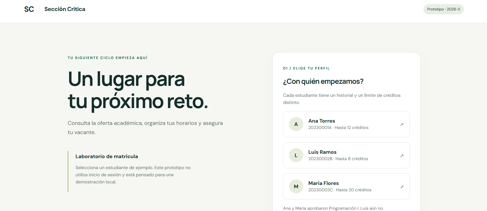
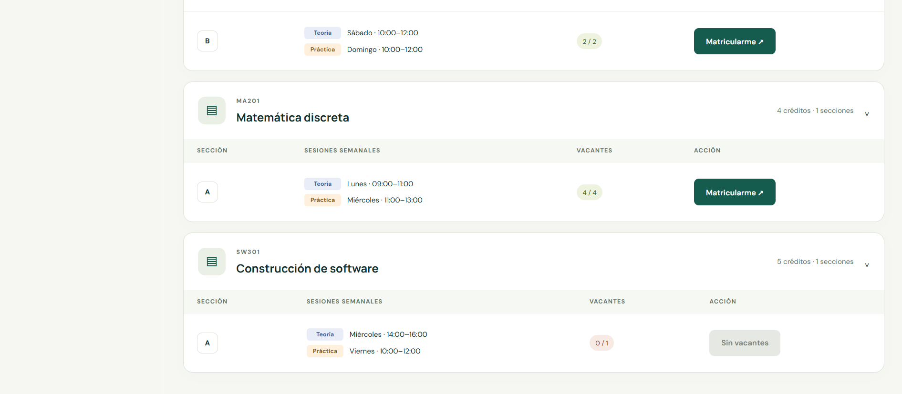
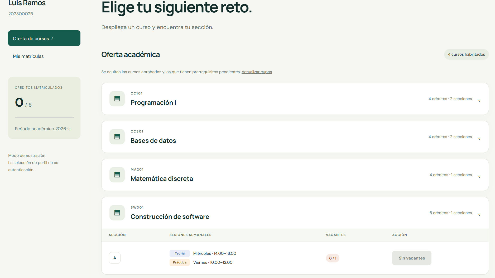
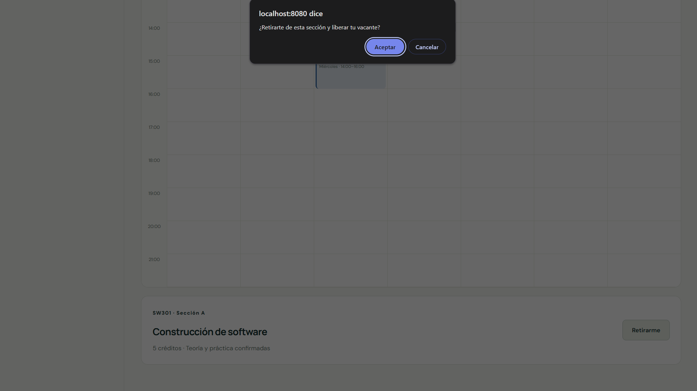
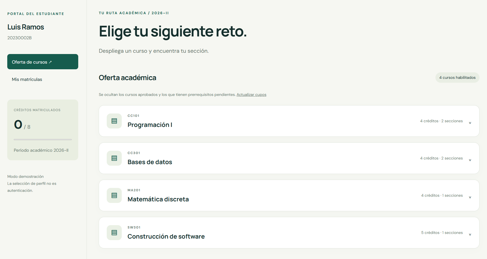
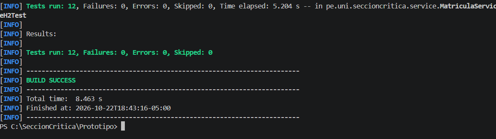
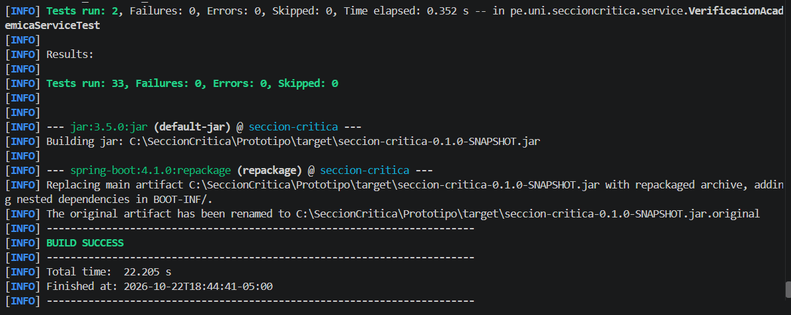
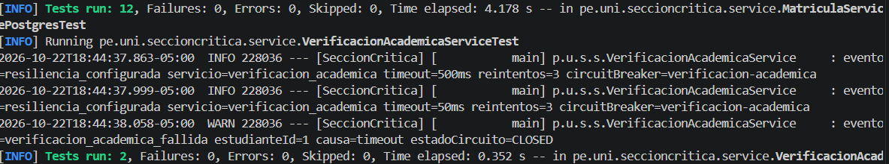
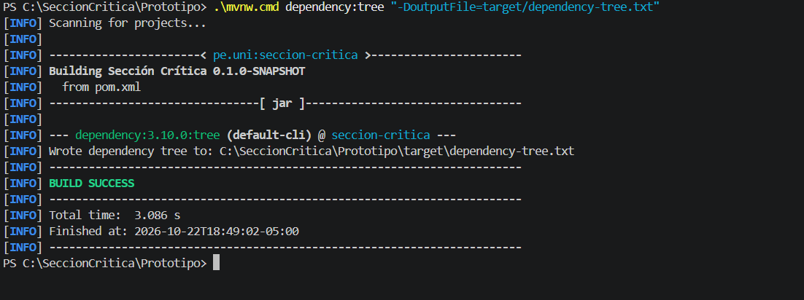

# Evidencias v1.0

| N.º | Nombre | Qué debe mostrar | Criterio |
|---:|---|---|---|
| 1 | `01-aplicacion.png` | Inicio, estudiantes de demo y/o health `UP` | Calidad y documentación |
| 2 | `02-matricula-exitosa.png` | Confirmación de Ana en sección 4 y cupo consumido | Reglas, pruebas y evidencias |
| 3 | `03-rechazo-cupo.png` | Rechazo de Luis al intentar la sección 4 agotada | Concurrencia / programación defensiva |
| 4 | `04-retiro-libera-cupo.png` | Retiro confirmado y vacante disponible | Contratos / transacciones |
| 5 | `05-reglas-academicas.png` | Prerrequisito, cruce horario o límite de créditos | Contratos / programación defensiva |
| 6 | `06-cinco-competidores.png` | Consola o reporte de `ultimoCupoTieneUnSoloGanador` | Concurrencia |
| 7 | `07-33-pruebas-build-success.png` | Resumen completo de las cuatro suites y `BUILD SUCCESS` | Pruebas y evidencias |
| 8 | `08-postgresql-testcontainers.png` | Contenedor `postgres:17` y salida de la suite PostgreSQL | Pruebas / dependencias |
| 9 | `09-arbol-dependencias.png` | Consola con `BUILD SUCCESS` y/o archivo de árbol | Dependencias y reúso |

### Evidencia 01. Aplicación funcionando

La aplicación web de Sección Crítica se encuentra disponible para la demostración local, junto con la selección de estudiantes y el estado de salud del servicio.

### Evidencia 02. Matrícula exitosa

Se muestra la confirmación de matrícula de Ana Torres en la sección 4 de Construcción de software y el consumo de la vacante disponible.

### Evidencia 03. Rechazo por falta de cupo

Se muestra el rechazo de la matrícula de Luis Ramos al intentar ingresar a una sección agotada.

### Evidencia 04. Retiro y liberación del cupo

Se muestra el retiro de una matrícula y la disponibilidad nuevamente liberada para la sección.

### Evidencia 05. Reglas académicas

Se muestran las validaciones académicas relacionadas con prerrequisitos, cruces de horario y límite máximo de créditos.

### Evidencia 06. Prueba de cinco competidores

Se muestra la ejecución del escenario concurrente en el que cinco estudiantes compiten por la última vacante.

La prueba verifica que exista un solo ganador, cuatro rechazos y un estado final consistente de la sección.

### Evidencia 07. Ejecución de las 33 pruebas

La ejecución de la suite v1.0 terminó con 33 pruebas, sin fallos, errores ni omisiones.

El resultado registrado fue `BUILD SUCCESS`.

### Evidencia 08. Pruebas de integración con PostgreSQL

Se ejecutaron las pruebas de integración de Sección Crítica utilizando PostgreSQL 17 mediante Testcontainers.

La clase `MatriculaServicePostgresTest` completó 12 pruebas exitosamente, sin fallos, errores ni omisiones.

### Evidencia 09. Árbol de dependencias Maven

Se muestra el árbol de dependencias Maven generado para la versión v1.0.

El comando terminó correctamente con `BUILD SUCCESS` y generó el archivo `target/dependency-tree.txt`.

